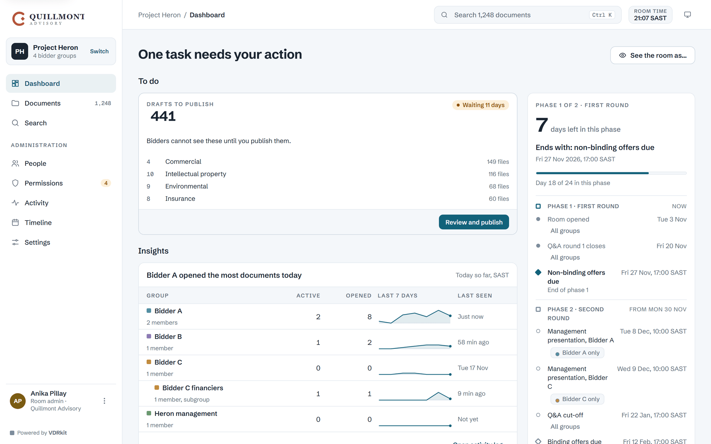
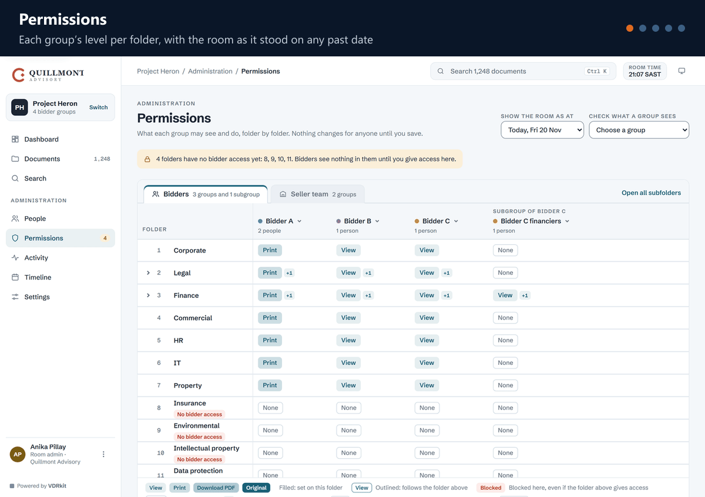

<p align="center">
  <a href="https://vdrkit.com"></a>
</p>

<h3 align="center">The open-source virtual data room for M&amp;A and due diligence</h3>

<p align="center">
  Give bidders, investors and advisers managed access to confidential documents, decide who sees what,<br>
  and keep a record nobody can quietly rewrite. On your own server.
</p>

<p align="center">
  <a href="LICENSE"></a>
  <a href="CHANGELOG.md"></a>
  <a href="docs/install.md"></a>
  <a href="https://github.com/vdrkit/vdrkit/stargazers"></a>
</p>

<p align="center">
  <a href="https://vdrkit.com"><b>Website</b></a> ·
  <a href="https://demo.vdrkit.com"><b>Try the sandbox</b></a> ·
  <a href="#documentation"><b>Docs</b></a> ·
  <a href="https://vdrkit.com/open-source.html#roadmap"><b>Roadmap</b></a> ·
  <a href="SECURITY.md"><b>Security</b></a>
</p>

<br>

<p align="center">
  
</p>

## Why VDRkit

M&A, capital raising, financing and other corporate transactions all run on due diligence, which means handing your most confidential documents to people you don't fully trust yet. Most data rooms are hosted services that charge per page, per user or per month, and keep your documents on their servers. We think you should be able to run your own. VDRkit runs on your server, with no per-page or per-user fees, and the code is open for anyone you hire to audit. Views, downloads and permission changes go into a hash-chained log. The application can't change or delete its entries, and a check finds any entry that was edited or removed without the chain being recomputed, though someone with owner access to the database could still rewrite it.

One installation serves one organisation: a corporate finance house, a law firm, or a company running its own deal. Version 1.0 is in a pilot.

## Features

The heart of it is the permission matrix. You set what each group may do in each folder: view, download a watermarked PDF, or download the original. There's a print level in the matrix too, but printing itself arrives in release 2, and until then that level only lets a group view. Subgroups, such as a bidder's financiers or advisers, never get more than the group they belong to.

Uploads start as drafts, and nothing reaches a bidder until someone publishes it. The publish step shows you which groups are about to see each file, and you can require a second person to do the publishing. Documents open in the browser as page images watermarked for each reader. Each room chooses what the watermark shows from name, email address, group, date and time.

Every view, download, refused attempt and permission change goes into that log. You can verify the chain and export it as CSV, and the dashboard shows which bidders are active and what they've been reading.

Bidders accept the NDA before they see anything. After that they get what's new since their last visit, their own deadlines and, if they want it, a daily email in their time zone.

There's also the less glamorous stuff a real deal needs:

- index numbers that survive renumbering
- bulk import of a whole folder tree
- resumable uploads up to 5 GB
- full-text search

Sign-in uses an emailed code or link plus an authenticator app; there are no passwords. Each room's files are encrypted at rest with their own key.

<p align="center">
  
</p>

The full list is in [docs/features.md](docs/features.md).

## Try it

The quickest way to get a feel for it is the sandbox at **[demo.vdrkit.com](https://demo.vdrkit.com)**. Pick someone in the demo room, the seller's room admin or a bidder, and click around. There's no sign-up. The companies and people are made up and the room resets every day, so feel free to break things.

## Self-host it

You'll need a Linux server with Docker Compose and at least 2 cores and 4 GB of memory, or 8 GB if you turn on the virus scanner. Point a domain name at it and have an SMTP server that's allowed to send mail for that domain.

```sh
git clone https://github.com/vdrkit/vdrkit.git && cd vdrkit
cp .env.example .env                        # fill in the address, passwords and keys
docker compose up -d
docker compose logs api | grep "Setup code"
```

Open your address and enter the setup code. Setup then asks for the first site admin, your organisation and the mail server. Before you put a real deal on it, read [docs/install.md](docs/install.md): it covers the DNS and email records, S3 storage, backups and upgrades.

We recommend the bundled Postgres; it's what we run and support. Other managed Postgres 16+ services should work too. Neon worked in our tests; support for it in production is on the roadmap.

## Documentation

- [Installation](docs/install.md), including backups, restore and upgrades
- [Features](docs/features.md)
- [Architecture](docs/architecture.md): how the parts fit together and how access, time and files are guarded
- [Development](docs/development.md)
- [Testing](docs/testing.md)
- [Performance](docs/performance.md) and server sizing
- [Accessibility](docs/accessibility.md)
- [Browsers](docs/browsers.md)
- [Sandbox](docs/sandbox.md), for running your own public demo
- [Screens](docs/screens.md)
- [Changelog](CHANGELOG.md)

## Contributing

Bug reports and pull requests are welcome. Please read [CONTRIBUTING.md](CONTRIBUTING.md) first. You'll be asked to sign the [Contributor Licence Agreement](CLA.md) on your first pull request: you keep the copyright in your work and give the project a permanent, irrevocable licence to use it as part of VDRkit, including under other licences.

## Security

Please report vulnerabilities privately, through GitHub's private vulnerability reporting or to security@vdrkit.com, not in a public issue. More in [SECURITY.md](SECURITY.md).

## Licence

Copyright (C) 2026 Shibula (Pty) Ltd.

VDRkit is free software: you can redistribute it and modify it under the terms of the GNU Affero General Public License, version 3 only (`AGPL-3.0-only`), as published by the Free Software Foundation. It comes with no warranty. See [LICENSE](LICENSE) and [NOTICE](NOTICE).

If you let people use a changed copy of VDRkit over a network, the AGPL requires you to offer them your source code. Set `VDRKIT_SOURCE_URL` to where you publish it, and "About and source code" in the account menu links there.

---

<p align="center">If VDRkit is useful to you, please star the repository.</p>
