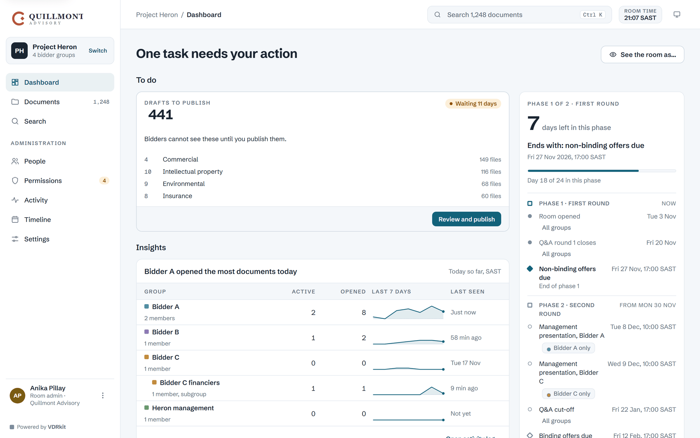
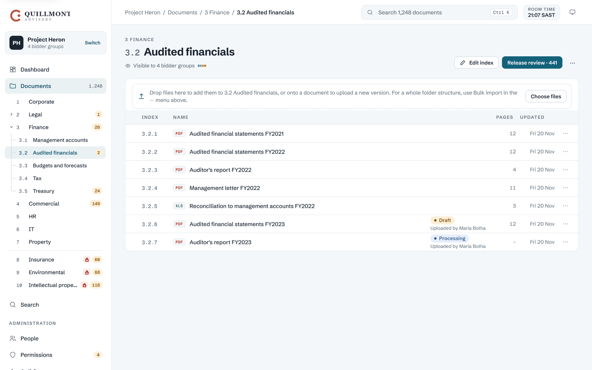
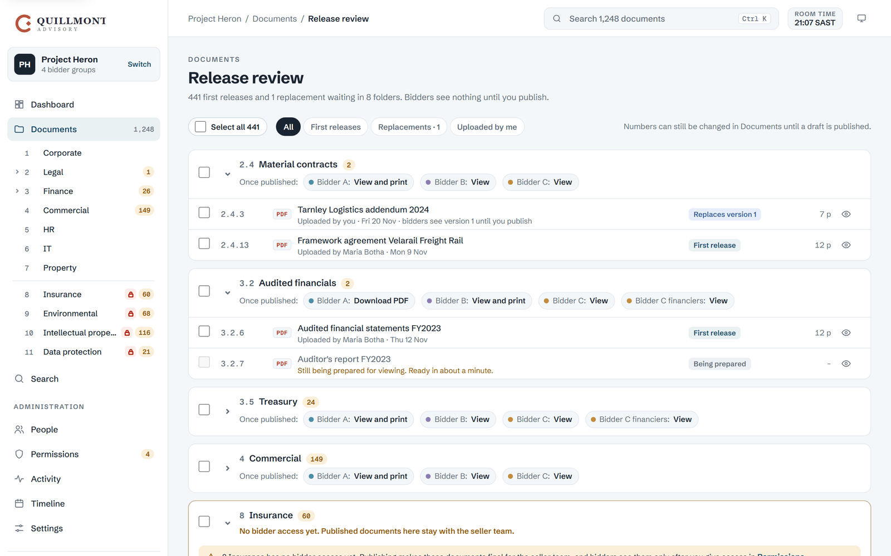
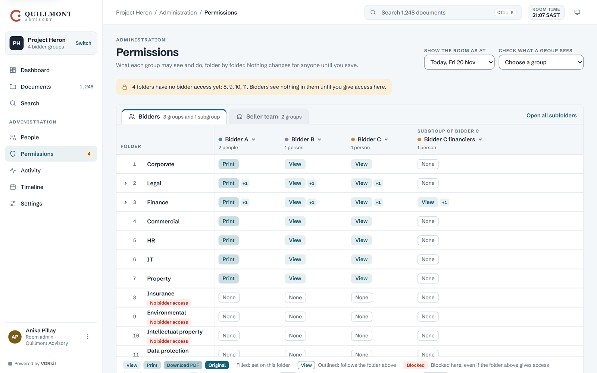
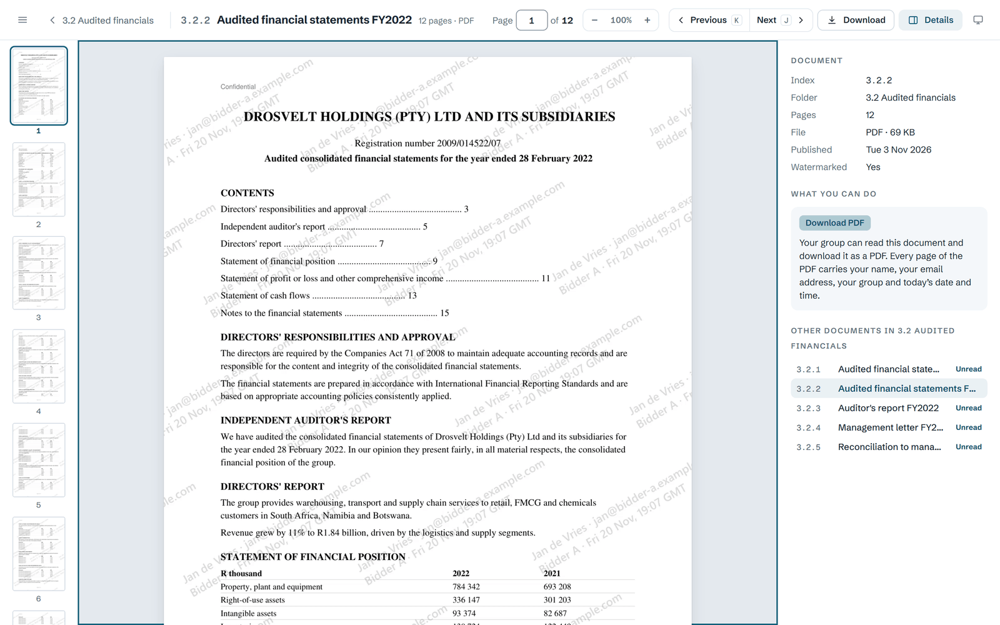
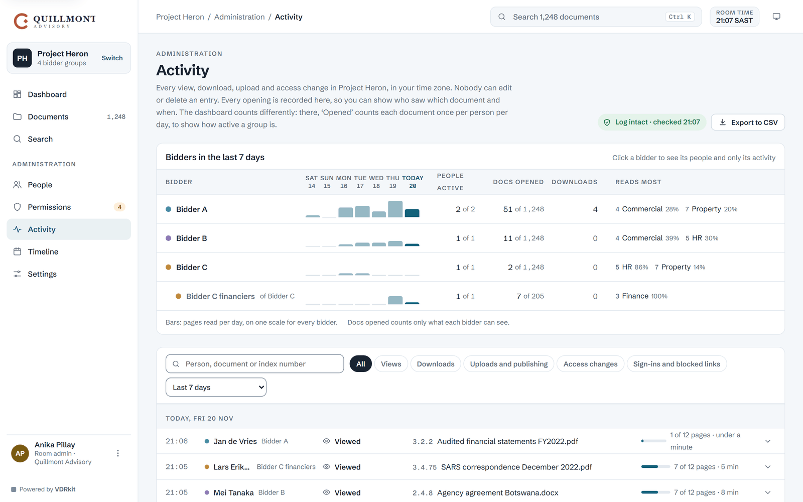

# What a room does

VDRkit is a virtual data room for M&A and other corporate transactions. The seller and its advisers put the deal documents in one room, decide folder by folder which bidder can see or download what, and keep a record of what everyone did. If you want to know what changed between releases, the [CHANGELOG](../CHANGELOG.md) has it.

## Documents

Every folder and document gets an index number like 3.2.1. You can renumber whenever you like; links and references to the old numbers keep finding the right document, which matters more than it sounds once a bidder has quoted "3.2.1" in a letter.

Uploads can be as large as 5 GB and pick up where they left off if the connection drops. For the initial load you'll usually want bulk import: point it at a whole folder tree, check the numbering it proposes, and only then let it create anything.

Anything new, including a new version of an existing file, starts as a draft that only the seller side can see. Someone with the right to publish releases it in release review. If your process needs four eyes, a room can insist that the person who uploaded a document isn't the one who publishes it.

## Who sees what

Each bidder is a group, and so is each of the seller's teams. A bidder's financiers go in a subgroup, which can never have more access than the bidder itself.

The permission matrix is where you set each group's level per folder: view, a watermarked PDF, or the original file. You'll also see a print level marked R2. Printing arrives in release 2; until then, that level gives a group view access. Uploading, publishing and managing are separate switches, and subfolders inherit from their parent. We keep the history of every grant, so you can look back at the room exactly as one bidder saw it last Tuesday. Before you open the room, preview it as each group; it's the quickest way to catch a folder you forgot to close.

## Reading

Documents open in the browser as page images carrying a watermark with whichever of the reader's name, email, group, time or IP address the room asks for. Office files are converted to PDF first. If ClamAV is installed, every file up to 1 GB is scanned for viruses before anyone can open it. Larger files aren't scanned, and nor is anything on an installation without ClamAV; the document's details say when a file wasn't. Search covers the full text of everything a person is allowed to see, and nothing else.

## The activity log

Everything that happens in a room ends up in an append-only log: views, downloads, refused attempts, uploads, releases, permission changes and the emails we send. Each entry carries a hash of the one before it. Room admins can check the chain whenever they like or export the log as CSV. Personal data is kept outside the hash, so erasing a person doesn't break the chain.

## Inviting people

You invite people by email. A room can make them accept an NDA before their first visit, and you can give access an end date or revoke it and restore it later. Bidder invitations are held back until the room opens. Bidder leads can ask for colleagues to be added or removed, and every bidder sees the deal timeline as it applies to them.

Each person decides how they hear about new documents and changes: straight away, in bundles, or in a daily summary in their own time zone. We check their access again just before each email goes out, and every email is logged.

## Signing in

There are no passwords. People sign in with a code or link sent by email, and two-factor sign-in with an authenticator app is on by default. Rooms choose whether browsers can be trusted and when idle sessions end; someone in several rooms gets the strictest rules of any of them. Files are encrypted with a key per room, and Postgres row-level security keeps organisations and rooms apart even if the API has a bug. [SECURITY.md](../SECURITY.md) goes into the details.

## Running your own

The first-run setup creates a site admin and asks for your mail settings. After that, site admins look after branding, outgoing email (there's an SPF, DKIM and DMARC check), accounts and who may create rooms, and they get an email when a health check fails. Installing, daily backups, restoring and upgrading with rollback are all in [install.md](install.md).

VDRkit runs in current Chrome, Edge, Firefox and Safari and aims at WCAG 2.2 AA. On a 4-core cloud server, 15 to 20 bidders can read at once before pages slow down. The [browser](browsers.md), [accessibility](accessibility.md) and [performance](performance.md) notes have more.
